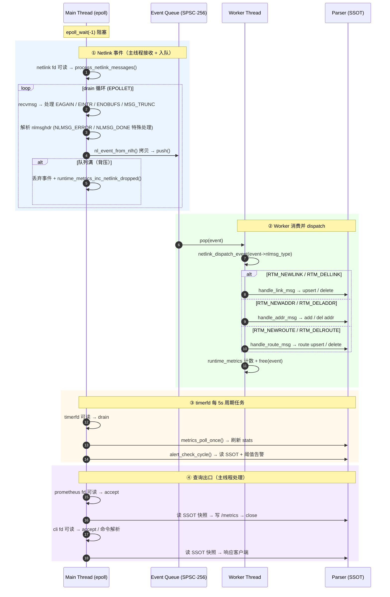

# Netlink-Agent 架构说明
## 1. 项目定位

> 基于 Netlink 的 Linux 网络状态监控与事件采集 Agent。

`nlagent` 订阅内核 `NETLINK_ROUTE` 事件，以事件驱动、低开销的方式维护一份用户态网络状态模型（接口 / 地址 / 路由），并通过 **Unix Socket CLI**、**Prometheus `/metrics`**、**结构化日志** 和 **运行时 metrics** 对外暴露；同时把 Netlink 接收与状态更新解耦，保证高事件吞吐下的稳定性。

核心关键词：`event-driven`、`epoll` + `timerfd`、`non-blocking`、`SPSC lock-free queue`、`worker thread`、`SSOT state model`、`atomic config reload`、`observable`、`deployable`。

## 2. 整体架构

```text
                      Linux Kernel
                          |
                 NETLINK_ROUTE events
                          |
                 +--------v---------+
                 |  Netlink Socket  |   (EPOLLET, non-blocking)
                 |  (link/addr/route)|
                 +--------+---------+
                          |
            recvmsg + parse nlmsghdr         (主线程 / epoll loop)
                          |
                          v   nl_event_from_nlh() 拷贝
                 +--------v---------+
                 |  SPSC Ring Buffer|   256 槽，原子 head/tail
                 |  (event_queue)   |   满则 drop + 计数（背压）
                 +--------+---------+
                          |
                pop + dispatch(nlmsg_type)    (worker 线程)
                          |
        +-----------------+------------------+
        |                 |                  |
   handle_link_msg   handle_addr_msg    handle_route_msg
        |                 |                  |
        v                 v                  v
   +----v----------------------------------------v----+
   |            Parser (SSOT)  — parser.c            |
   |  iface_list (rwlock)     route_list (rwlock)    |
   |  rtnl_link_stats64  /  addrs[]  /  route table  |
   +----+---------------------------------------+----+
        |                  |                   |
        v                  v                   v
    metrics            alert              CLI query / prometheus
  (5s timer)       (阈值检查)            (快照读 SSOT)
```

向外的可观测出口：

| 出口 | 实现 | 触发 |
|---|---|---|
| Unix Socket CLI | `cli.c` `/tmp/nlagent.sock` | epoll 可读 |
| Prometheus exporter | `prom.c` `:9100/metrics` | epoll 可读 |
| 运行时指标 | `runtime_metrics.c` | 各模块计数器 |
| 结构化日志 | `logger.c` | `log_info/warn/err` |

## 3. 进程与线程模型

进程内只有两类执行上下文：

- **主线程（`main.c`）**：`epoll_wait(-1)` 阻塞，处理所有 fd 可读事件。
  - 注册 `SIGINT / SIGTERM / SIGHUP`。
  - `SIGINT/SIGTERM` → 置 `running=0`，触发 graceful shutdown。
  - `SIGHUP` → `config_reload()`（环境变量热重载）。
- **Worker 线程（`event_worker.c`）**：唯一消费者，从 ring buffer `pop` 事件，`dispatch` 到 `parser` 更新 SSOT，然后 `free` 事件。空闲时 `nanosleep(100µs)` 自旋；退出时由主线程压入 sentinel 唤醒并 drain 剩余事件。

其余模块（metrics / alert / cli / prom / runtime_metrics / logger / config）均在主线程上下文调用，或作为 worker 写 SSOT 的被调用方。

## 4. 启动流程

入口 `src/main.c`：

```text
main()
├── signal(SIGINT/SIGTERM/SIGHUP)
├── perform_initialization()
│   ├── config_init_defaults()        // 双缓冲 config 默认值
│   ├── init_iface_table()            // getifaddrs() 建立初始 iface_list
│   └── update_all_iface_performance_data()  // 初始统计（netlink→sysfs 回退）
├── epoll_create1()
├── timerfd_create(CLOCK_MONOTONIC, 5s) → 加入 epoll
├── netlink_start(epfd)
│   └── bind NETLINK_ROUTE + EPOLLET 加入 epoll
│   └── 发送 RTM_GETADDR dump（pending_route_dump=1）
├── cli_start(epfd)                   // /tmp/nlagent.sock
├── prometheus_start(epfd)            // :9100（失败仅 warn）
├── event_queue_init() + netlink_set_event_queue()
├── event_worker_start()              // 启动 worker 线程
└── epoll_wait() 主循环
```

`netlink_start` 先发地址 dump，待收到 `NLMSG_DONE` 后再发路由 dump，从而完成初始状态同步（见 `netlink.c` 的 `pending_route_dump` 逻辑）。

## 5. 运行期事件流

`epoll_wait` 返回后按 fd 分发，主线程只负责「接收+入队」，worker 线程负责「出队+状态更新」，二者通过 SPSC 队列解耦：



关键细节（来自 `netlink.c`）：
- `process_netlink_messages()` 用 `for(;;)` drain 循环配合 `EPOLLET`，正确处理 `EAGAIN/EINTR/ENOBUFS/MSG_TRUNC`。
- `ENOBUFS` → `runtime_metrics_inc_netlink_overrun()`；`MSG_TRUNC` → `_inc_netlink_truncated()`。
- 队列满（`event_queue_push` 返回 false）→ `runtime_metrics_inc_netlink_dropped()` 并 `free`，即**背压丢弃**。

## 6. 模块职责

| 模块 | 文件 | 职责 |
|---|---|---|
| 进程入口 | `src/main.c` | 初始化、信号处理、`epoll` 主循环、周期性任务调度、shutdown |
| Netlink 生产者 | `src/netlink.c` / `.h` | 创建 `NETLINK_ROUTE` socket，订阅 link/addr/route 组，解析 `nlmsghdr`，拷贝为 `nl_event_t` 推入队列 |
| 事件队列 | `src/event_queue.c` / `.h` | SPSC 无锁 ring buffer（256 槽，原子 head/tail），`nl_event` 工厂 |
| Worker 线程 | `src/event_worker.c` / `.h` | 从队列 `pop` 事件，`dispatch` 给 parser，释放事件；支持 sentinel 唤醒与 drain |
| 状态模型 (SSOT) | `src/parser.c` / `.h` | 维护接口链表、地址列表、路由表、`rtnl_link_stats64`；提供线程安全读写 API；统计采集（netlink→sysfs 回退） |
| Metrics | `src/metrics.c` / `.h` | 周期性（5s）触发全接口统计刷新 `update_all_iface_performance_data()` |
| Alert | `src/alert.c` / `.h` | 遍历 SSOT，按 `config` 阈值检查错误计数与流量速率，输出 `WARN` 日志；内部用 tracker 链表记录上一轮计数 |
| CLI | `src/cli.c` / `.h` | Unix Domain Socket 查询入口（`show interfaces/interface/routes/metrics`、`reload`、`help`、`quit`） |
| Prometheus | `src/prom.c` / `.h` | HTTP `:9100/metrics` exporter，标准 HELP/TYPE 格式 |
| 配置 | `src/config.c` / `.h` | 双缓冲 `config_t` + 原子指针，支持 `SIGHUP`/CLI 热重载，来源为环境变量 |
| 运行时指标 | `src/runtime_metrics.c` / `.h` | 事件数 / 队列深度 / 丢弃 / 溢出 / CLI 计数 / worker 计数 的汇总与快照 |
| 日志 | `src/logger.c` / `.h` | 带时间戳的 `INFO` / `WARN` / `ERROR` 输出到 stdout |

## 7. 并发与一致性模型

这是本项目的核心设计，分三层：

1. **SPSC 无锁队列（`event_queue.c`）**
   - 单生产者（主线程 `netlink.c`）+ 单消费者（worker 线程 `event_worker.c`）。
   - `head`/`tail` 为 `_Atomic uint64_t`，用 `memory_order_release/acquire` 保证可见性，无互斥锁。
   - 容量 `EVENT_QUEUE_CAPACITY=256`（编译期固定）。满则生产者丢弃并计数，实现背压。

2. **SSOT 读写锁（`parser.c`）**
   - `iface_list` 受 `iface_list_lock`（`pthread_rwlock_t`）保护；`route_list` 受 `route_list_lock` 保护。
   - 写方：仅 worker 线程通过 `upsert/delete/route_*` 等 API 写。
   - 读方：CLI（`get_iface_list_safe()` 深拷贝快照 / `get_iface_snapshot_by_name()`）、metrics、alert、prom 均通过加锁 API 读取，避免读到半更新状态。

3. **配置双缓冲（`config.c`）**
   - `cfg_buf[2]` + `_Atomic(config_t *) g_config`，`config_reload()` 在另一块缓冲上基于当前值经环境变量覆盖后原子切换指针。
   - alert / dispatch 路径用 `atomic_load(&g_config)` 读取，实现零停机、并发安全的配置热重载。

4. **运行时指标锁（`runtime_metrics.c`）**
   - 全局 `metrics` 由 `pthread_mutex_t` 保护，所有计数接口加锁自增。

## 8. 状态模型

`parser.c` 是状态中心，维护两个全局链表：

```c
iface_info_t *iface_list;   // 受 iface_list_lock 保护
route_info_t *route_list;   // 受 route_list_lock 保护
```

核心结构：

- `iface_info_t`：接口名、接口索引、UP/DOWN 状态、`struct rtnl_link_stats64 stats`、地址数组 `addrs[MAX_ADDR_PER_IF]`（含 family / prefixlen / addr）、`addr_cnt`、链表指针。
- `iface_addr_t`：地址族、CIDR 前缀、地址字符串。
- `route_info_t`：family、prefixlen、oif、rtm_type、rtm_protocol、dst、gateway、链表指针。

状态来源：
1. 启动时 `getifaddrs()` 建立初始接口表与地址（无统计）。
2. 运行时 Netlink 事件（link/addr/route）增量更新。
3. 统计刷新优先 `RTM_GETLINK` + `IFLA_STATS64`（`update_iface_stats_via_netlink`），失败回退 `/sys/class/net/<ifname>/statistics/*`（`update_iface_performance_data`）。

状态消费者：
- `cli`：查询接口 / 路由（快照读）。
- `metrics`：刷新接口计数器。
- `alert`：遍历状态表进行阈值告警。
- `prometheus`：导出接口数量等 gauge。

## 9. 可观测性

- **Prometheus**：`prom.c` 在 `:9100/metrics` 暴露 `nlagent_netlink_events_total`、`nlagent_worker_events_total`、`nlagent_queue_depth`、`nlagent_queue_depth_max`、`nlagent_dropped_total`、`nlagent_errors_total`、`nlagent_overruns_total`、`nlagent_iface_count`、`nlagent_cli_connections_active`。
- **CLI `show metrics`**：在 Prometheus 指标基础上追加 link/addr/route 分类计数、last_event_ts、CLI 连接/命令/错误计数，以及基于 drop/event 计算的 `backpressure_pct`。
- **结构化日志**：`logger.c` 输出 `[时间戳] LEVEL: 消息`，覆盖链路变更、地址增删、路由增删、队列丢弃、配置重载等关键点。

## 10. 配置与热重载

`config_t` 字段：

```c
typedef struct {
    int    queue_capacity;          // 队列容量（注：当前队列容量由编译期宏固定，见 §11）
    int    error_threshold;         // 接口错误计数告警阈值
    double traffic_threshold_mbps;  // 接收速率告警阈值 (B/s = mbps * 1e6)
} config_t;
```

来源与重载：
- 默认值由 `config_init_defaults()` 设定（`queue_capacity=256`、`error_threshold=10`、`traffic_threshold_mbps=10.0`）。
- 重载来源为**环境变量**：`NLAGENT_QUEUE_SIZE`、`NLAGENT_ERR_THRESHOLD`、`NLAGENT_TRAFFIC_MBPS`。
- 触发方式：`SIGHUP` 信号，或 CLI `reload` 命令。
- 实现：双缓冲 + 原子指针，无停机、并发读安全。

## 11. 工程边界与已知问题

以下条目区分「已实现亮点」与「待改进」，**与代码现状逐一核对**。

### 已实现亮点
- Netlink 接收与状态更新通过 SPSC 无锁队列解耦。
- worker 线程消费 + sentinel 唤醒 + 退出 drain，graceful shutdown 基本闭环。
- 双缓冲配置热重载，并发读安全。
- 完整的 non-blocking / EPOLLET drain 循环与 `EAGAIN/EINTR/ENOBUFS/MSG_TRUNC` 处理。
- Prometheus exporter、runtime metrics、CLI、结构化日志构成可观测体系。
- `make asan`（ASan+UBSan）与 `make valgrind`、`tests/stress_test.sh` 压测体系。

### 待改进 / 已知不一致
- **配置文件未接入**：`conf/nlagent.conf` 完全未被代码读取，配置实际只来自环境变量（`config.c`）。`queue_capacity` 等字段在文件中写了也无效。
- **队列容量不可配**：`EVENT_QUEUE_CAPACITY=256` 是编译期宏，`config.queue_capacity` 在运行期并未作用于队列（与 `config_t.queue_capacity` 字段名语义不一致）。
- **systemd 路径不一致**：`systemd/nlagent.service` 的 `ExecStart=/opt/nlagent/nlagent`，而 `Makefile install` 安装到 `/usr/local/bin/nlagent`，两者不一致。
- **退出清理不完整**：`main()` 结束后未 `unlink("/tmp/nlagent.sock")`、未 `close(nl_sock)`、未 `close(prom_sock)`、未 `cleanup_iface_table()`，仅 stop worker / destroy queue / close timer & epoll。
- **路由表无界增长**：`route_list` 在高 churn 下只增不淘汰（无 LRU / 上限），早期文档的边界仍然成立。
- **告警过于简单**：`alert.c` 仅 reactive 检查，无 hysteresis / rate-limit / dedup；`error_threshold` 直接比对 `rx_errors`/`tx_errors` 绝对值（非增量）。
- **统计采集低效**：`update_iface_stats_via_netlink()` 每接口单独创建/关闭一个 netlink socket，可改为单 socket 批量请求。
- **未使用宏**：`parser.c` 中 `MAX_IFACES=128` 已定义但未被用于限制接口数量。

## 12. 演进路线

围绕主线「把 Netlink 事件稳定、低开销、可观测地转化为用户态网络状态模型」：

1. **工程稳定性**：补齐 graceful shutdown（清理 socket 文件 / fd / 状态表）；`conf` 文件解析接入，`make install` 与 systemd 路径对齐。
2. **IO 正确性**：保持 non-blocking / drain loop / `EAGAIN`/`EINTR`/`ENOBUFS` 处理；队列容量可配（让 `config.queue_capacity` 真正生效）。
3. **状态一致性**：明确 `parser` 为 SSOT，CLI 统一用快照；增强状态字段（`mtu`、`flags`、`operstate`）；`show interface <name>` 与 JSON 输出。
4. **可观测性**：增加事件数、错误数、最后事件时间、CLI 连接数等 runtime metrics；补齐 `backpressure_pct` 在 runtime_metrics / Prometheus 中的一致暴露。
5. **高性能解耦**：在 SPSC 基础上引入 backpressure 指标与更精细的批处理。
6. **验证体系**：压测、sanitizer、valgrind、CI；路由表 LRU 淘汰；告警去重与 hysteresis。
